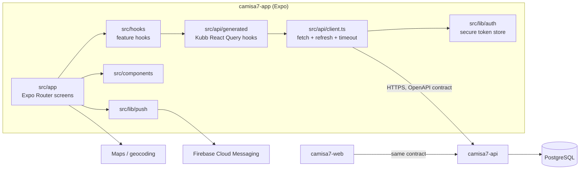

# Camisa7 App

Mobile app for organizing pickup football: create a group, schedule matches, confirm presence, pay by PIX, rate teammates and follow rankings.

**Status:** Prototype source, available for portfolio review. Not asserted to be in production; no usage or performance claims are made.

## What it does

- Sign in with email or Google; session tokens in secure storage with automatic refresh (`src/lib/auth`, `src/contexts/auth-context.tsx`).
- Groups, members, invite deep links and join requests (`src/app/group`, `src/app/j/[slug].tsx`).
- Matches and recurring series: attendance, team assignment, result, stats and votes (`src/app/match`, `src/app/series`).
- Player profiles, reputation and rankings (`src/app/player`, `src/app/(drawer)/rankings.tsx`).
- PIX payment of match attendance and membership dues (`src/components/payments`).
- Subscription plans (`src/app/(drawer)/planos.tsx`), venue/court discovery and booking (`src/app/court`, `reservas.tsx`).
- Push notifications via FCM and Notifee, opt-in by flag (`src/lib/push`).
- Location picker with map and reverse geocoding (`src/lib/location`, `src/components/location`).
- Brazilian Portuguese UI strings via i18next (`src/lib/i18n`).

## Architecture



- Screens never call `fetch`: they use hooks generated from `openapi.json` (`kubb.config.ts`), so API changes surface as type errors.
- One request wrapper handles base URL, timeout, bearer token and a single refresh-then-retry on 401, forcing logout if refresh fails (`src/api/client.ts`, `src/lib/auth/session.ts`).
- Server state lives in React Query (`src/api/query-client.ts`); feature hooks in `src/hooks/<feature>` own invalidation.
- Google Sign-In, push and Android maps are optional and flag/env-gated; without keys the app still runs.

### Core flow: confirm presence and pay

```mermaid
sequenceDiagram
  participant U as User
  participant S as Match screen
  participant H as Generated hook
  participant A as camisa7-api
  U->>S: tap "I'm in"
  S->>H: confirm presence mutation
  H->>A: POST attendance (bearer token)
  A-->>H: attendance confirmed
  H-->>S: invalidate match + attendance queries
  U->>S: tap "Pay"
  S->>H: pay mutation
  H->>A: POST attendance pay
  A-->>S: PIX QR and copy-paste code
  U->>U: pays in bank app
  Note over S,A: Provider webhook updates the API; the screen refetches and shows "paid".
```

## Key engineering decisions

- Contract-first client generation from a committed OpenAPI file: `kubb.config.ts`, `openapi.json`.
- NativeWind (Tailwind classes) for styling with shared theme tokens: `tailwind.config.js`, `src/lib/theme.ts`.
- Native modules kept optional so Expo Go keeps working for most screens: `app.config.ts`, `plugins/`.
- Zod + react-hook-form schemas per feature: `src/schemas/`.
- Money formatting centralized in integer cents: `src/lib/money.ts`.
- Test-only time zone pinned to UTC for deterministic date logic: `package.json` test script.

## Tech stack

Expo 57, React Native 0.86, React 19, Expo Router, TypeScript, NativeWind, TanStack Query, Kubb, react-hook-form + Zod, i18next, react-native-maps, Firebase Messaging + Notifee, Jest.

## Getting started

Prerequisites: Node >= 22, pnpm, Android Studio or Xcode for native builds, a running [camisa7-api](https://github.com/mkwitko/camisa7-api).

```bash
pnpm install --frozen-lockfile
cp .env.example .env
pnpm gen:api        # generates src/api/generated (git-ignored)
pnpm start          # dev client; first run: pnpm android | pnpm ios
```

| Name | Purpose |
|---|---|
| `EXPO_PUBLIC_API_URL` | Backend base URL |
| `EXPO_PUBLIC_GOOGLE_WEB_CLIENT_ID`, `EXPO_PUBLIC_GOOGLE_IOS_CLIENT_ID` | Google Sign-In (optional) |
| `EXPO_PUBLIC_PUSH_ENABLED` | Turn on FCM (needs Firebase config files, never committed) |
| `EXPO_PUBLIC_GOOGLE_MAPS_ANDROID_KEY` | Android map rendering (optional) |
| `EXPO_PUBLIC_PLACES_AUTOCOMPLETE_ENABLED` | Address autocomplete (optional) |

`.env.example` documents each variable.

## Testing

52 Jest suites, 207 tests (passing locally, along with `tsc --noEmit`). Run `pnpm gen:api` first.

```bash
pnpm typecheck && pnpm lint && pnpm test
```

## Project structure

```text
src/app         Expo Router screens (auth, drawer, group, match, court, ...)
src/api         request wrapper, query client, generated hooks
src/hooks       feature hooks over the generated API
src/components  UI by feature
src/lib         auth, push, location, i18n, money, theme
src/schemas     form validation
plugins/        Expo config plugins
openapi.json    API contract snapshot
```

## Related repositories

- [camisa7-api](https://github.com/mkwitko/camisa7-api): Fastify backend
- [camisa7-web](https://github.com/mkwitko/camisa7-web): public invite and profile pages

## License

All rights reserved. Source available for portfolio review.
